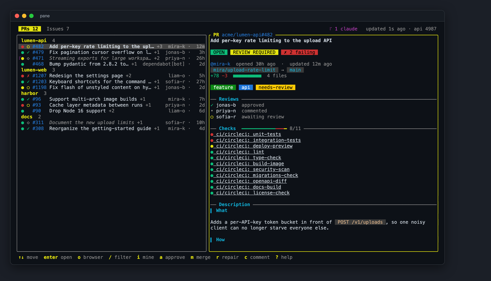
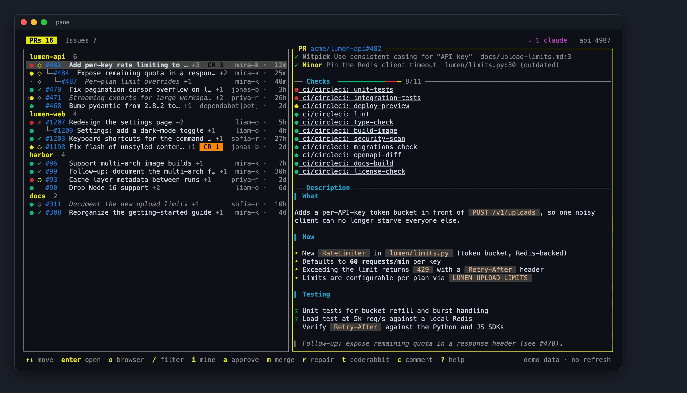
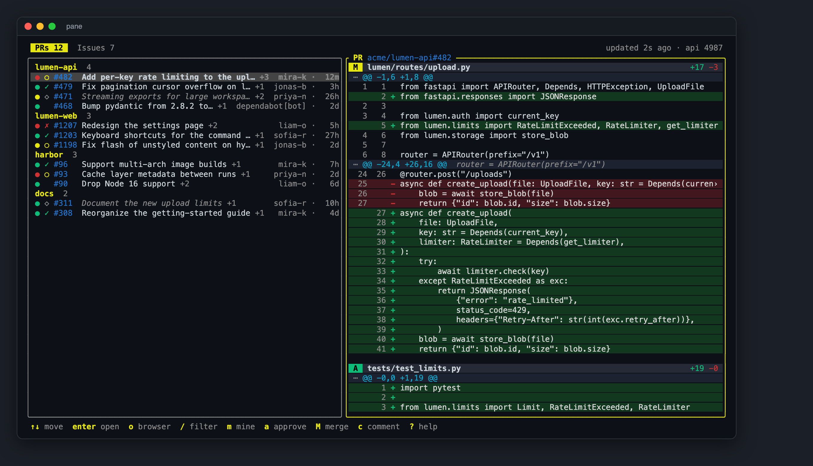
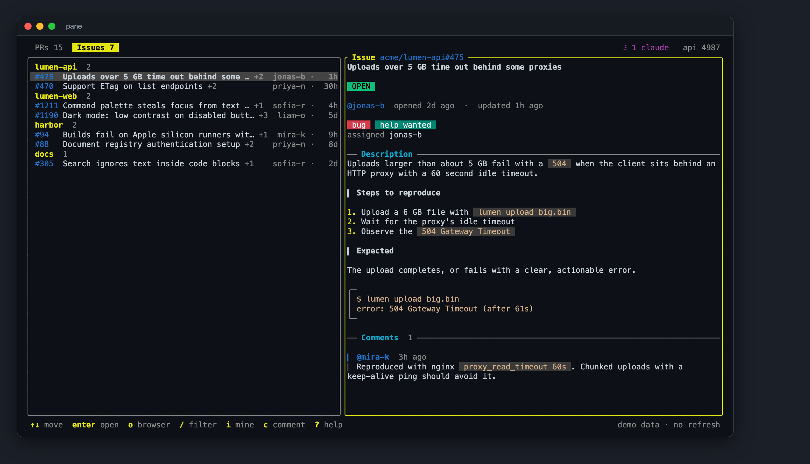

# pane

[](https://github.com/scale-venture-partners/pane/actions/workflows/ci.yml)
[](LICENSE)

A live terminal dashboard for your open GitHub pull requests and issues. Leave it running in a terminal pane all day; it polls GitHub at a polite rate and keeps the list current.



- PRs and issues in two tabs, grouped by repo, most recently active repo first.
- PR details are laid out as a card: state, review, CI and merge badges, branch chips, a `+/−` size bar, a check progress bar, rendered Markdown descriptions and comments (headings, lists, tasks, code blocks, links), and a diff with a file summary, line-number gutters and tinted added/removed rows.
- Per PR at a glance: CI state `●`, review state `✓ ✗ ○`, draft `◇`.
- Labels show as chips in GitHub's own colors, in rows (when there is room) and in details; `/` filtering matches label names.
- `◆` marks items that changed since you last looked at them.
- Click or press Enter for details: description, branch, diff size, mergeability, reviews, every check (click one to open it), recent comments, and the full diff at the bottom.
- Merge or close an item and it stays on screen marked `MERGED` or `CLOSED` until you move off it, then disappears.
- Basic actions without leaving the terminal: open in browser, copy URL, comment, approve, merge, close, toggle draft. Anything that writes asks `y/N` first.
- Filter by text, show only your own items, full mouse support.

<details>
<summary>More screenshots</summary>

Descriptions and comments render as Markdown:



A diff with a file summary, line numbers and tinted rows:



Issues get the same treatment, labels included:



</details>

Try it without a GitHub account: `pane --demo` runs on fictional data.

## Install

Requires the [GitHub CLI](https://cli.github.com) (`gh`), signed in with `gh auth login`. pane uses it for authentication and never handles tokens itself.

```sh
cargo install --git https://github.com/scale-venture-partners/pane
pane
```

Or from a clone: `cargo install --path .`

Works on macOS and Linux. Label colors use truecolor when `COLORTERM` says so and fall back to the nearest 256-color shade otherwise. Opening links uses `open` or `xdg-open`; copying uses `pbcopy`, `wl-copy`, `xclip` or `xsel`, whichever is found.

## Usage

With no config, pane shows open PRs and issues that involve you, plus PRs awaiting your review. Press `?` for all keys. Every command is a single letter, and upper case does the same as lower case.

| Key | Action |
| --- | --- |
| `↑` `↓` `j` `k` | move |
| `Enter` `l` / `Esc` `h` | open / close details |
| `Tab` `1` `2` | switch PRs and issues |
| `/` | filter by text |
| `i` | only my items |
| `u` `F5` | update now |
| `o` `y` | open in browser, copy URL |
| `f` | open the first failing check |
| `d` | jump to the diff (PR details) |
| `]` `[` | next / previous file in the diff |
| `a` `m` `x` `w` | approve, merge, close, toggle draft (each confirms) |
| `c` | comment |
| `r` | repair: run Claude on the PR (edit the prompt, Enter to run) |
| `t` | list Claude runs |
| `q` | quit |

## Configuration

Optional file at `~/.config/pane/config.toml` (or `$XDG_CONFIG_HOME/pane/config.toml`). See [`config.example.toml`](config.example.toml).

| Key | Default | Meaning |
| --- | --- | --- |
| `refresh_secs` | `90` | poll interval; minimum 15 |
| `merge_method` | `"squash"` | `squash`, `merge` or `rebase` |
| `orgs` | `[]` | show every open item in these orgs |
| `repos` | `[]` | extra `owner/name` repos to show |
| `claude_prompt` | `"Rebase this PR on its base branch and fix any failing checks."` | default prompt for the Claude action |
| `claude_args` | `["--permission-mode", "auto"]` | extra arguments for `claude` |
| `claude_worktree` | `true` | run Claude in its own git worktree |
| `repo_roots` | `~/code`, `~/src`, `~/dev`, `~/projects`, `~/GitHub`, `~/Documents/GitHub` | where to look for local clones |

When both `orgs` and `repos` are empty, pane shows items that involve you.

`pane --demo` runs the UI on fictional data, with no network. `scripts/screenshots.sh` regenerates the screenshots above from it.

`pane --check` prints the URL of every item pane would show, then exits. Handy for verifying a config.

## Repairing a PR with Claude

Press `r` (repair) on a PR, adjust the prompt if you like, and press Enter. pane runs [`claude -p`](https://docs.claude.com/en/docs/claude-code) in the background; the PR row shows a spinner and the header counts running jobs. When a job finishes, the status bar shows the first line of what Claude said. `t` lists every run with Claude's full reply (cut to a few lines), the log path, and a warning if it left work behind; `o` there opens the newest log.

- **Your Claude setup:** the job inherits your environment and runs `claude` exactly as you would, so your global settings, credentials, hooks and permission rules apply. `claude -p` has nobody to approve prompts, so pane passes `--permission-mode auto` by default: Claude's auto mode approves routine actions (editing files, running git) on its own, while risky ones are still blocked, and the run then ends with Claude explaining what it was blocked on. Change this with `claude_args` (for example `["--permission-mode", "acceptEdits"]` to be stricter, or `[]` to use only your own settings).
- **Where it runs:** in your local clone of the repo, found by matching `origin` against the PR's repository under `repo_roots`.
- **Isolation:** by default each job gets its own git worktree (`.claude/worktrees/`, added to the repo's local `.git/info/exclude`), so your working copy is untouched. When the job ends, the worktree is deleted if it has no uncommitted changes and everything is pushed; otherwise it is kept and its path is reported. Set `claude_worktree = false` to run in the checkout itself.
- **Context:** the prompt is prefixed with the PR number, title, URL, and head and base branches.
- **Logs:** `~/.local/state/pane/claude/` (or `$XDG_STATE_HOME/pane/claude/`), one file per run with the full prompt and output.

Jobs keep running if you quit pane.

## Rate limits

Each refresh issues a few GraphQL search queries (one per org, one per ~4 repos, twice for PRs and issues). At the default interval that is well under GitHub's hourly allowance; the header shows how many calls remain.

## Development

```sh
cargo fmt --check
cargo clippy --all-targets -- -D warnings
cargo test
```

See [CONTRIBUTING.md](CONTRIBUTING.md).

## License

[MIT](LICENSE)
