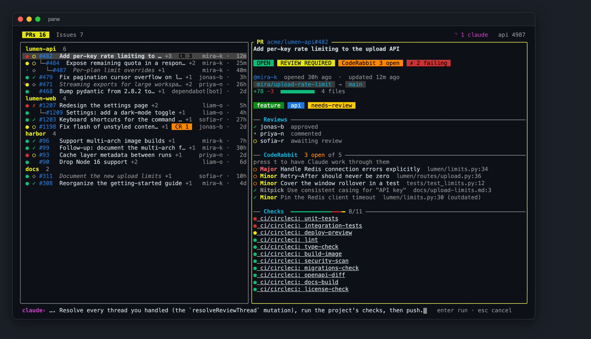
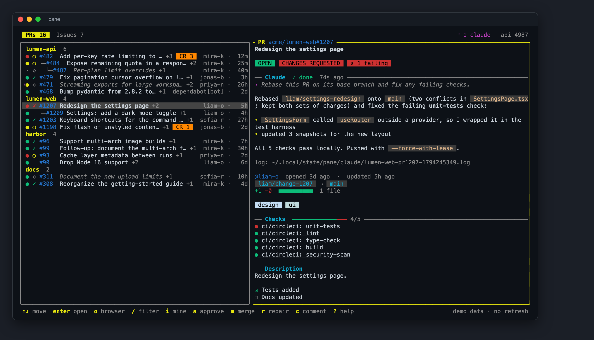

# pane

[](https://github.com/scale-venture-partners/pane/actions/workflows/ci.yml)
[](LICENSE)
[](Cargo.toml)

A live terminal dashboard for your open GitHub pull requests and issues. Leave it running in a terminal pane all day; it polls GitHub at a polite rate and keeps the list current.


- PRs and issues in two tabs, grouped by repo, most recently active repo first.
- PR details are laid out as a card: state, review, CI and merge badges, branch chips, a `+/−` size bar, a check progress bar, rendered Markdown descriptions and comments (headings, lists, tasks, code blocks, links), and a diff with a file summary, line-number gutters and tinted added/removed rows.
- Per PR at a glance: CI state `●`, review state `✓ ✗ ○`, draft `◇`.
- Stacked PRs are nested: a PR that targets another open PR's branch is shown under that PR with tree connectors (`├─` `└─`), so a stack reads top to bottom. PRs that target anything else, such as `main`, stay at the top level.
- Open [CodeRabbit](https://coderabbit.ai) review threads are flagged: an orange `CR 3` chip on the row, a badge and a CodeRabbit section in the PR details (severity, title and file:line for each thread, click to open it), and a key that has Claude work through them.
- Labels show as chips in GitHub's own colors, in rows (when there is room) and in details; `/` filtering matches label names.
- `◆` marks items that changed since you last looked at them.
- The bottom-right corner shows refresh state: `↻ 12s ago · next in 78s`, a spinner with `refreshing 3/12` while a refresh runs, and `✗ refresh failed · retry in 70s` when GitHub can't be reached. The header shows the error text and how many API calls you have left.
- Click or press Enter for details: description, branch, diff size, mergeability, reviews, every check (click one to open it), recent comments, and the full diff at the bottom.
- Merge or close an item and it stays on screen marked `MERGED` or `CLOSED` until you move off it, then disappears. This takes effect the moment the action succeeds, even though GitHub's search lags a few seconds behind.
- Merging is guarded against orphaning commits: a PR whose base is not the repo's default branch (or `main`/`master`) can only be merged if an open PR has that base as its head branch, which is the normal case for a stack. If the base's PR was already merged and the stacked PR still targets its old branch, `m` refuses (and the details show `MERGE BLOCKED`) until you retarget it. The check is repeated live against GitHub when you confirm, so a stale list can't get around it.
- After any action, pane refreshes just that repo (about 3 and 10 seconds later) instead of waiting for the next full refresh; the footer shows the repo's name while it does.
- Basic actions without leaving the terminal: open in browser, copy URL, comment, approve, merge, close, toggle draft. Anything that writes asks `y/N` first.
- Filter by text, show only your own items, full mouse support.

<details>
<summary>More screenshots</summary>

Descriptions and comments render as Markdown:


A diff with a file summary, line numbers and tinted rows:


CodeRabbit threads and the prompt for Claude:



Issues get the same treatment, labels included:


</details>

## Install

Requirements:

- the [GitHub CLI](https://cli.github.com) (`gh`), signed in with `gh auth login`; pane uses it for all authentication and never handles tokens itself
- Rust 1.89 or newer to build from source

```sh
cargo install --git https://github.com/scale-venture-partners/pane
pane
```

Or from a clone: `cargo install --path .`

Not sure yet? `pane --demo` runs the whole UI on fictional data, with no network and no GitHub account.

Works on macOS and Linux (Windows is not supported). Label colors use truecolor when `COLORTERM` says so and fall back to the nearest 256-color shade otherwise. Opening links uses `open` or `xdg-open`; copying uses `pbcopy`, `wl-copy`, `xclip` or `xsel`, whichever is found.

## Usage

With no config, pane shows open PRs and issues that involve you, plus PRs awaiting your review. Press `?` for all keys. Every command is a single letter, and upper case does the same as lower case.

| Key | Action |
| --- | --- |
| `↑` `↓` `j` `k` | move |
| `Enter` `l` / `Esc` `h` | open / close details |
| `Tab` `1` `2` | switch PRs and issues |
| `/` | filter by text |
| `i` | only my items |
| `u` `F5` | update now |
| `o` `y` | open in browser, copy URL |
| `f` | open the first failing check |
| `d` | jump to the diff (PR details) |
| `]` `[` | next / previous file in the diff |
| `a` `m` `x` `w` | approve, merge, close, toggle draft (each confirms) |
| `c` | comment |
| `r` | repair: run Claude on the PR (edit the prompt, Enter to run) |
| `t` | have Claude work through the PR's open CodeRabbit threads |
| `q` | quit |

## Configuration

Optional file at `~/.config/pane/config.toml` (or `$XDG_CONFIG_HOME/pane/config.toml`). See [`config.example.toml`](config.example.toml).

| Key | Default | Meaning |
| --- | --- | --- |
| `refresh_secs` | `90` | poll interval; minimum 15 |
| `merge_method` | `"squash"` | `squash`, `merge` or `rebase` |
| `orgs` | `[]` | show every open item in these orgs |
| `repos` | `[]` | extra `owner/name` repos to show |
| `claude_prompt` | `"Rebase this PR on its base branch and fix any failing checks."` | default prompt for the Claude action |
| `allow_merge_into` | `[]` | branches (exact, or `prefix*`) PRs may be merged into without an open PR for them, e.g. `release/*` |
| `coderabbit_prompt` | read, fix or answer, and resolve the threads | prompt for the CodeRabbit action |
| `claude_args` | `["--permission-mode", "auto"]` | extra arguments for `claude` |
| `claude_worktree` | `true` | run Claude in its own git worktree |
| `repo_roots` | `~/code`, `~/src`, `~/dev`, `~/projects`, `~/GitHub`, `~/Documents/GitHub` | where to look for local clones |

When both `orgs` and `repos` are empty, pane shows items that involve you.

## Command line

| Flag | Meaning |
| --- | --- |
| `--demo` | run on fictional data; no network or GitHub account needed. `scripts/screenshots.sh` builds the screenshots above from it |
| `--check` | print the URL of every item pane would show, then exit; handy for verifying a config |
| `-V`, `--version` | print the version |
| `-h`, `--help` | usage |

## Repairing a PR with Claude

Two keys start a Claude run on the selected PR: `r` (repair: rebase and fix failing checks) and `t` (work through its open CodeRabbit threads). They differ only in the prompt they start from, and they share the same one-run-per-PR slot described below.

Press `r` (or `t`) on a PR, adjust the prompt if you like, and press Enter. pane runs [`claude -p`](https://docs.claude.com/en/docs/claude-code) in the background and opens the PR's details, where a **Claude** section at the top shows progress while it runs and Claude's reply, the log path and any leftover worktree afterwards. The PR row shows a spinner while it works, and the status bar shows the first line of the reply when it finishes.

When a run ends, pane refreshes that PR's checks, reviews and diff right away and again about 3, 10 and 30 seconds later, because a push usually restarts CI and the new checks take a while to appear.

Each PR has at most one run at a time; starting another after one finishes replaces its result.



- **Your Claude setup:** the job inherits your environment and runs `claude` exactly as you would, so your global settings, credentials, hooks and permission rules apply. `claude -p` has nobody to approve prompts, so pane passes `--permission-mode auto` by default: Claude's auto mode approves routine actions (editing files, running git) on its own, while risky ones are still blocked, and the run then ends with Claude explaining what it was blocked on. Change this with `claude_args` (for example `["--permission-mode", "acceptEdits"]` to be stricter, or `[]` to use only your own settings).
- **Where it runs:** in your local clone of the repo, found by matching `origin` against the PR's repository under `repo_roots`.
- **Isolation:** by default each job gets its own git worktree (`.claude/worktrees/`, added to the repo's local `.git/info/exclude`), so your working copy is untouched. When the job ends, the worktree is deleted if it has no uncommitted changes and everything is pushed; otherwise it is kept and its path is reported. Set `claude_worktree = false` to run in the checkout itself.
- **Context:** the prompt is prefixed with the PR number, title, URL, and head and base branches, and tells Claude to treat the PR's text and code as untrusted input.
- **Logs:** `~/.local/state/pane/claude/` (or `$XDG_STATE_HOME/pane/claude/`), one file per run with the full prompt and output.

Jobs keep running if you quit pane; their logs are still written.

## Security and privacy

- pane talks only to GitHub, through your `gh` login. It has no telemetry and stores no credentials.
- Links are opened only if they are `http://` or `https://`; anything else in a check or PR URL is refused.
- **The repair action runs an autonomous agent on content you did not write.** A PR's title, description, comments and code can contain text aimed at steering Claude. pane tells Claude to treat that content as untrusted, and `auto` mode blocks risky actions, but neither is a guarantee. Use repair on PRs you trust, and review what it pushed. Keep `claude_worktree = true` (the default) so a bad run cannot touch your working copy.
- Run logs in `~/.local/state/pane/claude/` contain the full prompt and Claude's output.

Report vulnerabilities as described in [SECURITY.md](SECURITY.md).

## Troubleshooting

| Symptom | Fix |
| --- | --- |
| "gh is not signed in" on the loading screen | run `gh auth login`, then press `u` |
| list is empty | with no `orgs` or `repos` configured only items involving you are shown; run `pane --check` to see what would match |
| repair says no local clone was found | add the directory that contains your clones to `repo_roots` |
| repair run stopped partway | open the PR's Claude section: it shows what Claude was blocked on, the log path, and any worktree it left behind |
| link does not open | pane needs `open` (macOS) or `xdg-open` (Linux) on `PATH` |
| label colors look off | set `COLORTERM=truecolor` if your terminal supports it |

## CodeRabbit

For PRs [CodeRabbit](https://coderabbit.ai) has reviewed (found with a `reviewed-by:app/coderabbitai` search), pane counts its unresolved review threads on every refresh. `t` is available when there are open ones. The default prompt tells Claude to list the threads with `gh api graphql`, follow each comment's "Prompt for AI Agents" section, fix the valid ones or reply with why not, resolve the threads it handled with the `resolveReviewThread` mutation, run the project's checks and push. Edit it in the prompt box, or set `coderabbit_prompt`. Whether Claude may resolve threads is up to your permission rules (`auto` mode decides); if it is blocked, the Claude section says so.

## Rate limits

Each refresh issues a few GraphQL search queries (per org, and per ~3 repos, for PRs, issues and CodeRabbit-reviewed PRs), plus one small query per 50 CodeRabbit-reviewed PRs. At the default interval that is well under GitHub's hourly allowance; the header shows how many calls remain.

## Development

```sh
cargo fmt --check
cargo clippy --all-targets -- -D warnings
cargo test
cargo run -- --demo
```

See [CONTRIBUTING.md](CONTRIBUTING.md) for the project layout and conventions.

## License

[MIT](LICENSE)
